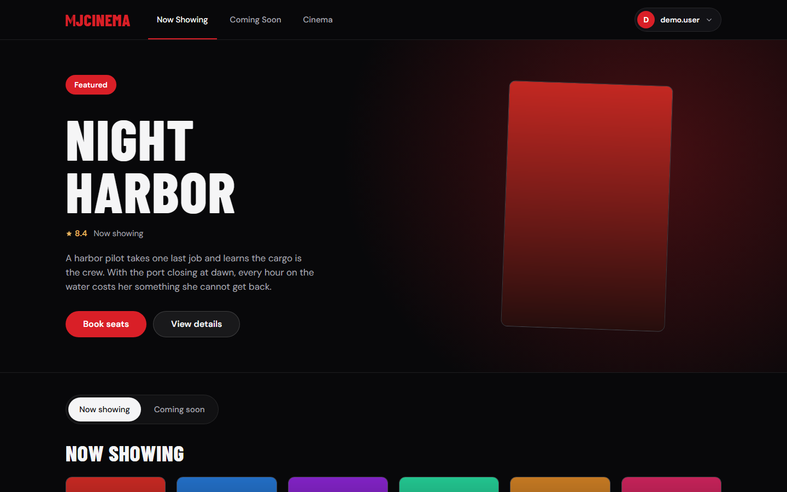
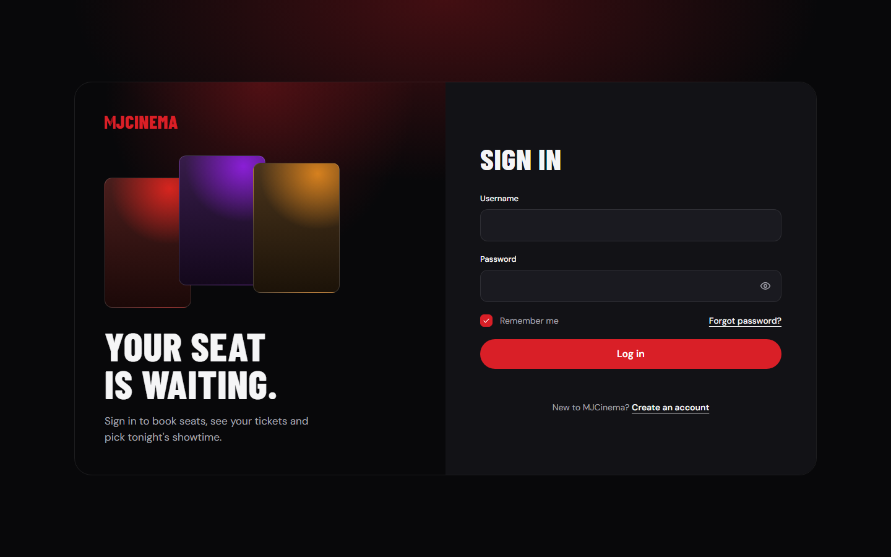
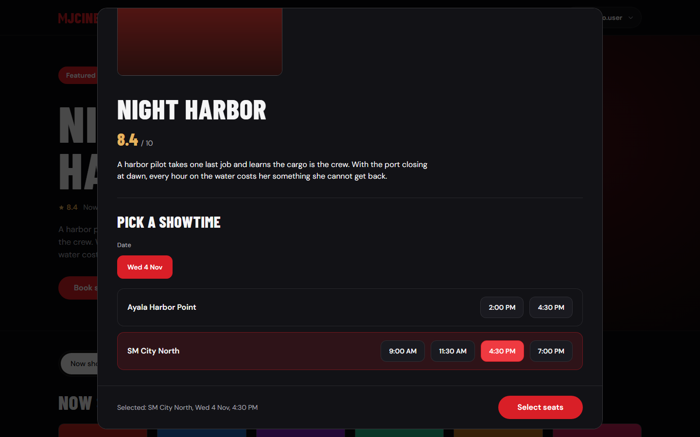
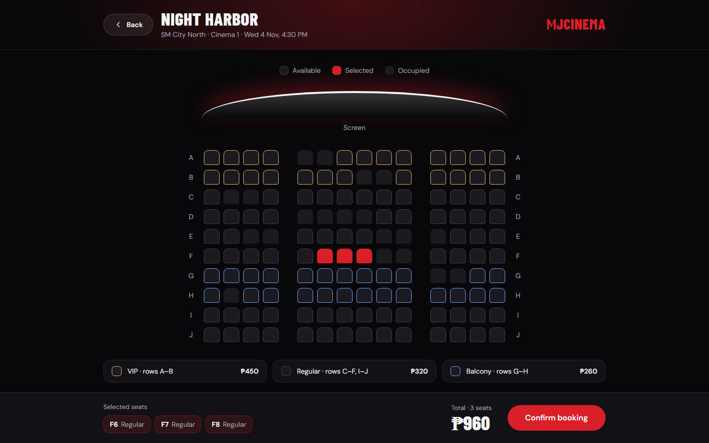
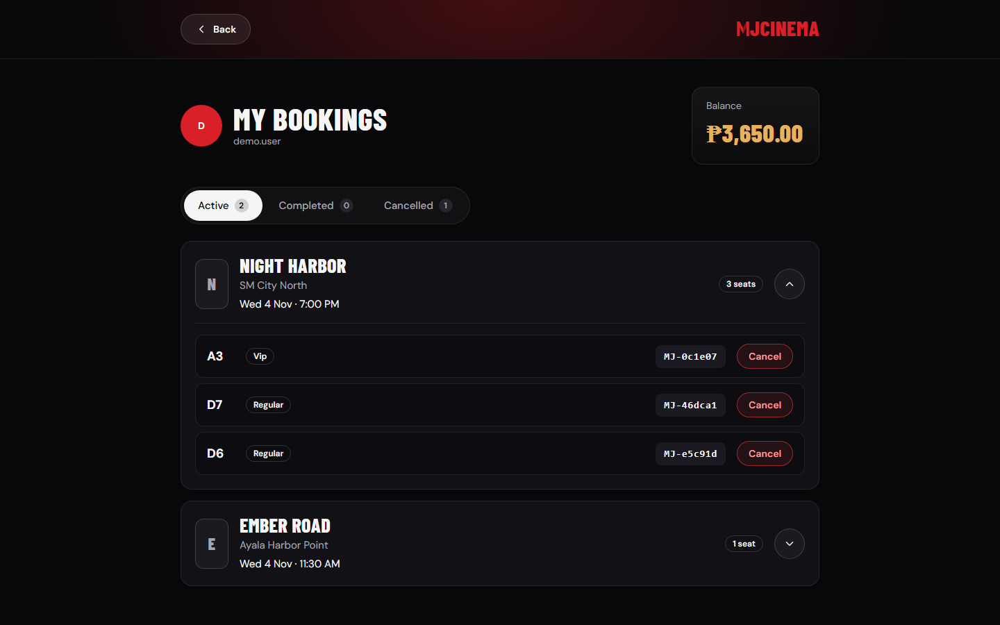
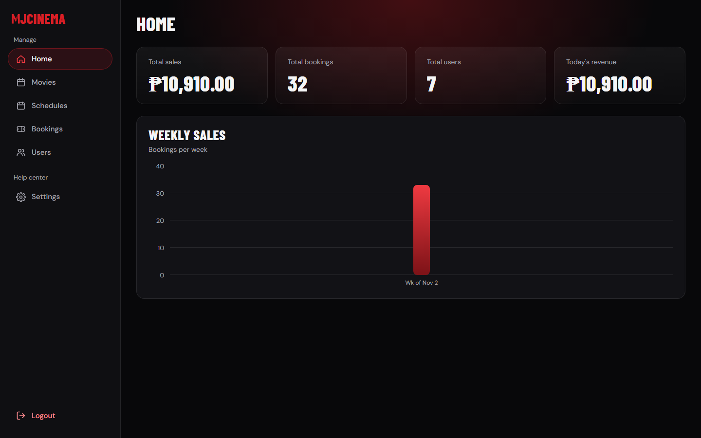
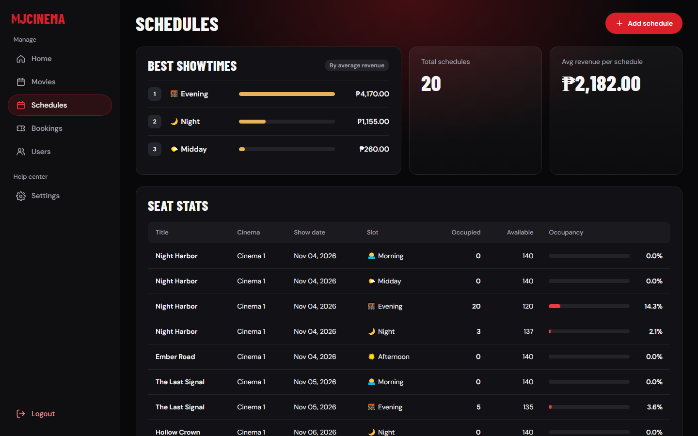
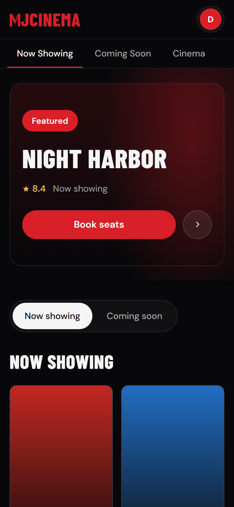
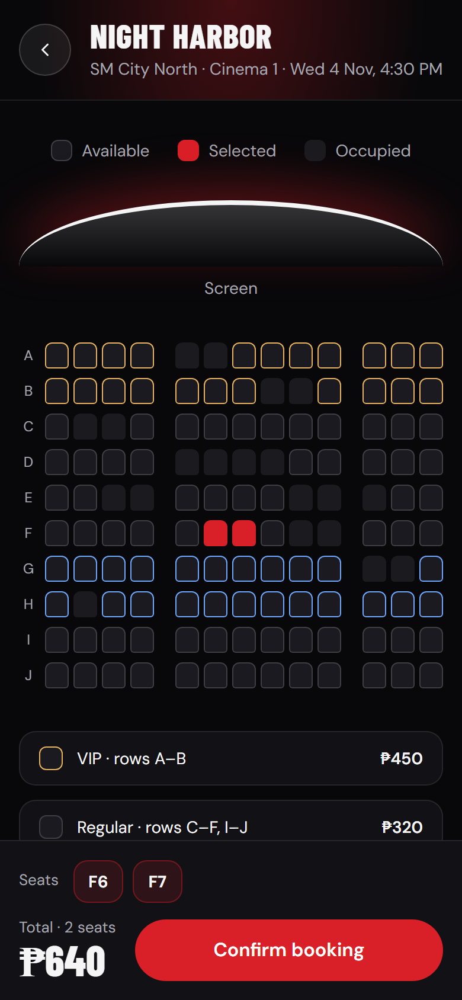
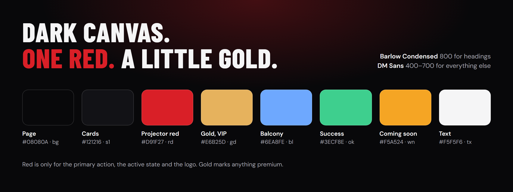

<p align="center">
  
</p>

<h3 align="center">The Spring Boot backend behind MJCinema: seats, wallet payments, showtimes and an admin analytics API.</h3>

<p align="center">
  Browse what's on, pick exact seats, pay from an in-app wallet, cancel for an automatic refund. Admins run the cinema from live analytics.
</p>

<p align="center">
  
  
  
  
  
  
  
</p>

<p align="center">
  
</p>

> The screenshots in this README are generated by Playwright (`npm run shots` in [`playwright/`](playwright)). They show the real React app talking to this backend, filled with made-up demo data. The poster art is generated gradients, not real posters; the app itself loads real TMDB posters.

---

## Where the project is right now

**Current phase: Phase 4 has started (measuring and indexes are done). Phase 3 and the hardening pass are finished, and "Session and deploy" is being wrapped up.**

For the last stretch the work has been a **performance and reliability pass**: the app felt slow because almost every request did database writes, ran one query per row and talked to a remote database. The plan has six phases:

| Phase | What | Status |
|---|---|---|
| **1. Quick wins** | SQL logging off, secrets moved to environment variables, connection pool tuned, `open-in-view` off, lazy-loaded posters. | ✅ Done |
| **2. Stop writing on reads** | Movie, schedule and ticket statuses are refreshed by a few bulk `UPDATE`s once a minute (and after admin changes), not on every page load. `Coming soon` is one query. | ✅ Done |
| **3. Remove N+1 queries** | Seat stats are one grouped query. Booking looks up seats, prices and taken seats once for the whole request. Associations are lazy, with DTOs and `JOIN FETCH` where JSON is returned. | ✅ Done |
| **Hardening** (found while testing phase 3) | Cancelling a schedule now cancels its tickets. No more double refunds. Row locks stop two people booking the same seat, or one wallet being spent twice. Cancelled schedules no longer show up or block their time slot. | ✅ Done |
| **Session and deploy** | Protected endpoints answer **401 JSON** instead of redirecting to a login page. The React app treats a 401 as "session expired", clears storage and returns to the login screen. Vercel serves the SPA for deep links (refreshing `/dashboard` used to 404). | 🔄 **Current.** Built and tested locally. Next: deploy the backend to Render, then the frontend to Vercel, and check the live site. |
| **4. Indexes and heavy queries** | Indexes on the columns the queries filter by, pagination for `GET /ticket/showBookings`, the weekly sales trend computed in SQL, short-lived caching for dashboard totals. Measure before and after. | 🔄 **Started.** Done: measuring and the five indexes (see [measurements](docs/performance-measurements.md)). Next: weekly trend in SQL, pagination, caching. |
| **5. Remove network latency** | A local MySQL for development; run the app in the same region as the production database. | ⏭ Planned |
| **6. Frontend polish** | Cache the movie lists for a session, loading skeletons everywhere. | ⏭ Planned |

**What we are doing at this moment**
- Phase 4, step by step: a timing filter and query counter are in (`TimingFilter`), the indexes are added and measured. The weekly sales trend in SQL, pagination of `showBookings` and caching of the dashboard totals come next.
- Verifying the session-expiry flow end to end (backend 401 + frontend redirect) and getting it deployed.
- Keeping this README and the test suite in step with the code.

**What the measurements say so far.** On a generated data set of 280,000 tickets (local database, so no network delay), the five indexes made the once-a-minute status refresh about **4x faster** (about 385 ms to about 99 ms), the admin analytics endpoints take **15 to 27% less time**, and one query that sorted every ticket (newest bookings) went from **75 ms to under 0.1 ms**. Everyday endpoints such as the seat map, booking and movie showtimes did not change, because they were already fast. The indexes cost about 20% slower bulk inserts and 11.5 MB of disk at this size. The full numbers, the method and the limits are in [docs/performance-measurements.md](docs/performance-measurements.md). The biggest remaining cost is the heavy analytics endpoints, which an index cannot fix; those need the weekly-trend change and caching.

---

## What it does

MJCinema covers the whole ticketing lifecycle: browsing what's showing, picking exact seats, paying from an in-app wallet, cancelling for a refund, and for admins, running the cinema from an analytics dashboard.

### For moviegoers
- **Now Showing and Coming Soon**: current and upcoming screenings across multiple cinemas.
- **Interactive seat map**: pick specific seats; taken seats are marked from live data.
- **Tiered pricing**: `VIP`, `REGULAR` and `BALCONY` seats, each priced per schedule.
- **Wallet payment**: the ticket price is deducted from the balance at booking.
- **My Bookings and cancellation**: view bookings, cancel a seat, get the money back automatically.
- **Account tools**: register, log in, change password.

### For admins
- **Movie management**: add movies by hand or import metadata from **TMDB**.
- **Cinema and schedule management**: add cinemas, create showtimes, cancel schedules (all booked users are refunded).
- **Seat pricing**: the price of each seat category, per schedule.
- **Analytics**: total sales, revenue today, weekly sales, bookings, users, active movies, average revenue per schedule, seat occupancy per showtime, a movie leaderboard and a best-showtime report.

---

## The screens

<table>
  <tr>
    <td width="50%"></td>
    <td width="50%"></td>
  </tr>
  <tr>
    <td align="center"><sub>Sign in</sub></td>
    <td align="center"><sub>Movie details with the showtime picker (<code>GET /schedule/movieSchedules/{id}</code>)</sub></td>
  </tr>
  <tr>
    <td width="50%"></td>
    <td width="50%"></td>
  </tr>
  <tr>
    <td align="center"><sub>Seat map, price tiers and live total (<code>/seat/occupied</code>, <code>POST /ticket/book</code>)</sub></td>
    <td align="center"><sub>My bookings with per-seat cancel (<code>/ticket/mytickets</code>, <code>PATCH /ticket/cancel</code>)</sub></td>
  </tr>
  <tr>
    <td width="50%"></td>
    <td width="50%"></td>
  </tr>
  <tr>
    <td align="center"><sub>Admin home: sales, bookings, users, weekly sales</sub></td>
    <td align="center"><sub>Admin schedules: best showtimes and seat stats (the single grouped query from phase 3)</sub></td>
  </tr>
</table>

<p align="center">
  
  &nbsp;&nbsp;&nbsp;
  
</p>
<p align="center"><sub>Phone layouts (390 px wide)</sub></p>

---

## Branding

The frontend lives in its own repository, **[MJCinema-frontend](https://github.com/Jenel-web/MJCinema-frontend)** (React 19, TypeScript, Vite, Tailwind 4). Its look is a dark, poster-first interface in the way Netflix presents a catalogue: a near-black canvas, one confident red, large poster art and a single featured title up front.

<p align="center">
  
</p>

| | |
|---|---|
| **Logo** | The red `MJCINEMA` wordmark with a folded "M" (`docs/logo.png`). |
| **Colours** | Page `#08080A`, cards `#121216`, projector red `#D91F27` (primary action, active state, logo), gold `#E6B25D` (ratings, VIP, balance), balcony blue `#6EA8FE`, success `#3ECF8E`, warning `#F5A524`. |
| **Type** | **Barlow Condensed** 800 for headings, **DM Sans** for everything else. |
| **Rules** | Red is only for the primary action, the active state and the logo. Gold marks anything premium. Every data view has loading, empty and error states. |

---

## Architecture

```
┌──────────────────────────┐   HTTPS + JWT    ┌──────────────────────────────────────┐
│  React SPA  (Vercel)     │ ───────────────▶ │  Spring Boot REST API  (Render)      │
│  MJCinema-frontend/web   │ ◀─────────────── │                                      │
└──────────────────────────┘       JSON       │  JwtFilter → Controllers → Services  │
                                              │        │                    │        │
   401 JSON  ─▶  the app clears its           │   GlobalExceptionHandler   TMDB API  │
   session and returns to the login screen    │                    ▼                 │
                                              │        Spring Data JPA Repositories  │
                                              └──────────────────┬───────────────────┘
                                                                 ▼
                                                              MySQL 8
```

**Domain model:** `Users` · `Cinema` · `Movie` · `Schedule` · `Seat` · `SeatPrice` · `Tickets`, with status enums `MovieStatus`, `ScheduleStatus` (`ACTIVE`, `CANCELLED`, `COMPLETED`), `TicketStatus` (`ACTIVE`, `CANCELLED`, `REFUNDED`, `COMPLETED`, `EXPIRED`) and `SeatCategory`.

The backend still ships the original vanilla-JS pages under `src/main/resources/static/`. They are the old frontend and are kept as a fallback; new work happens in the React app.

---

## Engineering highlights

| Area | What's under the hood |
|---|---|
| **Transactional integrity** | Booking and cancellation each run in one `@Transactional` unit: seat check, balance check, deduction, ticket creation. If any step fails, everything rolls back. Cancelling a ticket or a whole schedule refunds the wallet in the same transaction. |
| **Double-booking protection** | `bookTicket` takes a pessimistic row lock on the schedule and then on the user, always in that order. Two people going for the same seat, or one user double-spending a wallet, run one after the other, and the second gets a clear *"Seat is already taken"* or *"Insufficient balance"*. A test fires six users at one seat at once and exactly one wins. |
| **No double refunds** | A ticket that is not `ACTIVE` cannot be cancelled again. A schedule that is already cancelled or completed cannot be cancelled again. Cancelling a schedule also marks its tickets `CANCELLED`. |
| **Status refresh without writes on reads** | Movies move between `NOW_SHOWING`, `COMING_SOON` and `INACTIVE`, schedules to `COMPLETED`, and tickets to `COMPLETED`, through bulk JPQL updates run by a `@Scheduled` job every minute and after admin changes. |
| **Query shape** | Seat stats, coming soon and the seat map use single queries instead of one per row. Booking loads seats, prices and taken seats once per request. Associations are lazy; JSON responses use DTOs or `JOIN FETCH`. |
| **Schedule conflict detection** | `existsOverlappingSchedule` rejects a showtime that collides with another active one in the same cinema, date and slot. A cancelled showtime frees its slot. |
| **Stateless JWT auth** | `JwtFilter` + `JWTService` (jjwt 0.12) authenticate each request; sessions are `STATELESS`; passwords are hashed with **BCrypt**. An expired, malformed or missing token is treated as not logged in and answered with a **401 JSON** `{ "message": "Please log in to continue." }`, never a 500 and never a redirect. |
| **Role-based access** | `@EnableMethodSecurity` with `@PreAuthorize("hasRole('ADMIN')")` on every management and analytics endpoint. Public browsing, authenticated booking. |
| **Global exception handling** | A `@RestControllerAdvice` turns exceptions into structured JSON so the frontend can show meaningful messages. |
| **DTO pattern** | Purpose-built DTOs keep entities off the wire; most reports are constructor-expression JPQL (`SELECT new …DTO(…)`) straight from the database. |
| **Third-party integration** | `TmdbService` calls the TMDB API to search movies, fetch details and list popular titles. |
| **Deployment-ready** | Multi-stage `Dockerfile` (Maven build, then a slim JRE) with JVM flags tuned for a 512 MB host such as Render. The port comes from `$PORT`. |

---

## API overview

| Base path | Access | Highlights |
|---|---|---|
| `POST /user/register`, `/user/login` | Public | Create an account, receive a JWT |
| `/user/**` | Authenticated | Profile, tickets, `PATCH /user/change/password` |
| `/schedule/now-showing`, `/coming-soon`, `/seats`, `/{id}`, `/movieSchedules/{id}` | Public | Browse screenings |
| `/schedule/add`, `PATCH /schedule/cancel/{id}` | **Admin** | Manage showtimes |
| `/schedule/seatStats`, `/bestShowtime`, `/showAverageRevenue`, … | Public | Scheduling analytics |
| `/movie/show`, `/movie/leaderboard`, `/movie/tmdb/{search,details,popular}` | Public | Catalogue and TMDB lookups |
| `POST /movie/add` | **Admin** | Add a movie |
| `/cinema/all`, `/cinema/movies/{id}` | Public | Cinemas and their movies |
| `/seat/occupied/{id}` | Public | Taken seats for a schedule |
| `POST /ticket/book`, `PATCH /ticket/cancel`, `GET /ticket/mytickets` | Authenticated | Booking flow |
| `/ticket/totalSales`, `/showBookings`, `/showRevenueToday`, `/getSalesTrend` | **Admin** | Sales reporting |

Protected endpoints without a valid `Authorization: Bearer <token>` header return `401` with a JSON body. CORS allows `http://127.0.0.1:5500`, `http://localhost:5500`, `https://mjcinemaapp.vercel.app` and `https://mj-cinema-frontend.vercel.app` (see `SecurityConfig`).

---

## Getting started

### Prerequisites
- JDK 17+
- A MySQL 8 database
- A [TMDB API key](https://www.themoviedb.org/settings/api) (for movie import)

### 1. Configure
`application.properties` reads everything from environment variables, so no secret is stored in the repository:

| Variable | Meaning |
|---|---|
| `DB_HOST` | **Hostname only**, for example `mysql.example.com`. The JDBC URL is built from it. |
| `DB_PORT` | Optional, defaults to `10955` (the production host). Use `3306` for a local MySQL. |
| `DB_NAME` | Optional, defaults to `mjcinema`. |
| `DB_USER`, `DB_PASSWORD` | Database login. |
| `TMDB_API_KEY`, `TMDB_BASE_URL` | For example `https://api.themoviedb.org/3`. |
| `PORT` | Optional, defaults to `8080`. |

Hibernate runs with `ddl-auto=update`, so the tables are created on first start.

### 2. Run the backend

```bash
./mvnw spring-boot:run
```

The API is on `http://localhost:8080`.

### 3. Run the frontend (separate repository)

```bash
git clone https://github.com/Jenel-web/MJCinema-frontend
cd MJCinema-frontend/web
npm install
VITE_API_URL=http://localhost:8080 npm run dev -- --host 127.0.0.1 --port 5500 --strictPort
```

Open `http://127.0.0.1:5500`. That port is pinned because it is one of the origins the backend's CORS allows.

### 4. Or run the backend with Docker

```bash
docker build -t mjcinema .
docker run -p 8080:8080 --env-file .env mjcinema
```

---

## Testing

End-to-end tests live in [`playwright/`](playwright). They call the real API and drive the real UI, against a throwaway database, never production.

```bash
cd playwright
npm install
sh seed.sh        # empties the test database and adds one cinema, 16 seats, 3 movies and an admin
npx playwright test
```

You need the backend running on `localhost:8080` against an empty test database (the scripts assume MySQL on port `3307` and `C:/mysql-client/bin/mysql.exe`; change the paths at the top of `seed.sh` and `shots/demo-data.js` for your machine).

| File | What it proves |
|---|---|
| `01-query-refactors.spec.js` | The phase 2 and 3 changes keep behaving: status refresh, JSON shapes, seat map, multi-seat booking and its failure cases, seat stats, schedule refunds. |
| `02-fixes-and-sessions.spec.js` | The hardening pass and the session work: cancelling schedules and tickets (also twice, also at the same moment), six users racing for one seat, one wallet spent twice, 401 JSON with CORS headers, and UI tests for login, booking a seat end to end and the "Session Expired" path. |

The two files share one database and run in file-name order. 26 tests in total. The frontend repository has its own suite (`npm run e2e` in `web/`), including `session-expired.spec.ts` for the 401 handling.

**Regenerating the README screenshots**

```bash
# backend on :8080 and the frontend dev server on 127.0.0.1:5500, as in "Getting started"
npm run shots     # in playwright/; wipes the test database, adds demo data, writes docs/screenshots/*.png
```

---

## Project layout

```
src/main/java/com/MovieBookingApplication/MJCinema/
├── Config/        Security, CORS, page forwards, project beans
├── Controllers/   Cinema · Movie · Schedule · Seat · Tickets · Tmdb · User
├── DTO/           Request / response models
├── Entity/        JPA entities and enums
├── Filters/       JwtFilter
├── Repository/    Spring Data JPA, custom JPQL, bulk updates, row locks
└── Services/      Business logic, JWT, TMDB client, exception handler

src/main/resources/static/   The original vanilla-JS frontend (legacy fallback)
playwright/                  End-to-end tests, test-database seed, README screenshot script, performance measuring scripts (measure/)
docs/                        Logo and README screenshots
```

---

## Roadmap ideas
- Phases 4 to 6 above (indexes, pagination, caching, latency, frontend polish).
- A route guard in the frontend for `/admin` and `/dashboard`.
- A database-level guard against double booking, as a second layer behind the row locks.
- Payment gateway instead of wallet balance.
- Email or QR ticket confirmation, and a seat-hold timer while checking out.

---

<div align="center">

Built by **Mark Jenel Cortas** · Made with ☕ and a love of cinema.

</div>
